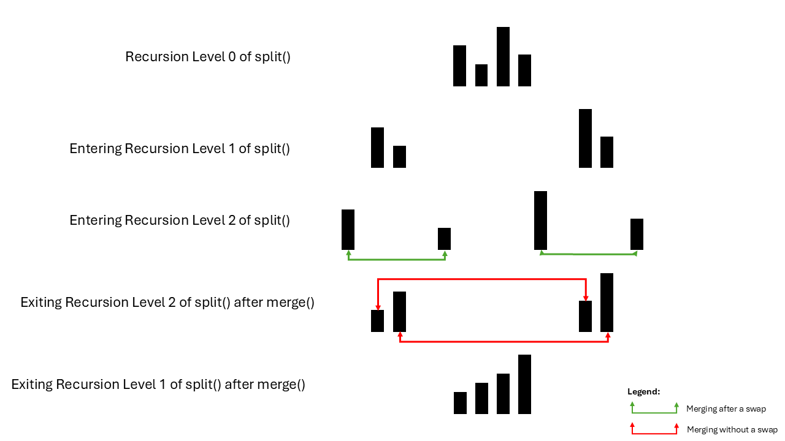

<h1>
  <span class="headline">Merge Sort in Java</span>
  <span class="subhead">Merge Sort</span>
</h1>

**Learning objective:** By the end of this lesson, you'll be able to explain a merge sort algorithm.

## Introduction to merge sort
Merge Sort is a sorting algorithm that follows a divide-conquer-combine approach to sort data in linear data structures like arrays:

- **Divide** _(Split by length)_ : Recursively keep splitting an array into two sub-arrays of equal length until each half contains a single element.
- **Conquer**  _(Merge)_ : Starting from the bottom most (single element) sub-arrays, compare the elements in each sub-array pair and merge them to a third array in a sorted manner. The recursion logic in the **Divide** step takes care that the merge process is repeated for all the sub-arrays created by each split in a LIFO manner (the last split is sorted and merged first). 



## Pseudocode for merge sort
```plaintext
FUNCTION split(array):
    IF size of array <= 1:
        RETURN array

    SET mid = length of array / 2
    SET left = split(array[0:mid])
    SET right = split(array[mid:end])

    RETURN merge(left, right)

FUNCTION merge(left, right):
    INITIALIZE mergedArray = []
    INITIALIZE i, j = 0, 0

    WHILE i < length(left) AND j < length(right):
        IF left[i] <= right[j]:
            APPEND left[i] to mergedArray
            SET i += 1
        ELSE:
            APPEND right[j] to mergedArray
            SET j += 1

    APPEND remaining elements from left to mergedArray
    APPEND remaining elements from right to mergedArray

    RETURN mergedArray
```
## Time complexity of merge sort
Merge Sort is renowned for its consistent performance across all cases—best, average, and worst—with a time complexity of (O(n \log n)). This efficiency stems from the algorithm's strategy of dividing the array into halves and then merging them back together. Each division reduces the array size logarithmically, while merging them back requires linear time at each recursion level.

## Space complexity of merge sort
Unlike some other sorting algorithms, Merge Sort is not an in-place algorithm and therefore requires additional space. The space complexity for Merge Sort is (O(n)) due to the necessity of allocating an auxiliary array to help in merging the sorted sub-arrays. This factor becomes particularly significant when dealing with large arrays, as the additional space requirement can be substantial.

## Advantages of merge sort
1. Guaranteed 𝑂(𝑛 log 𝑛) time complexity.
2. Preserves the order of equal elements.
3. Very efficient in handling a variety of unsorted data.
4. It's robust especially when using large datasets.

## Drawbacks of merge sort
1. Uses additional space for left and right arrays (auxiliary arrays) during merging and, hence, adding an additional space complexity of O(n).
2. Performs poorly for small datasets due to relatively high overhead.
3. Because it uses recursion, its recursive overhead can increase for very large data.
